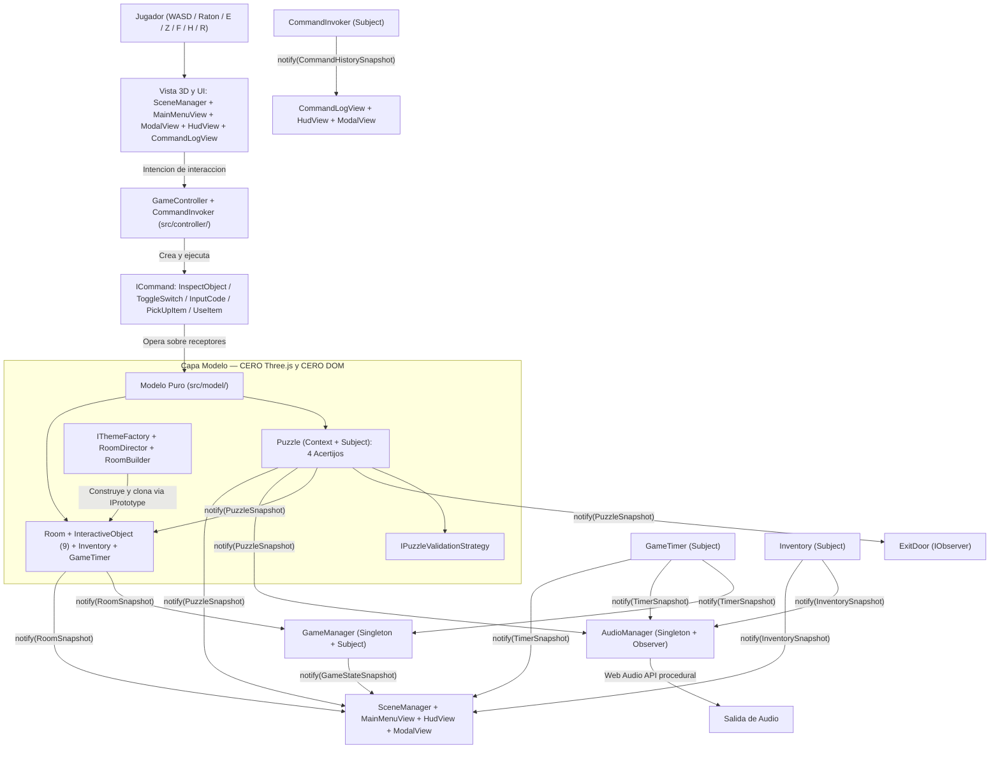
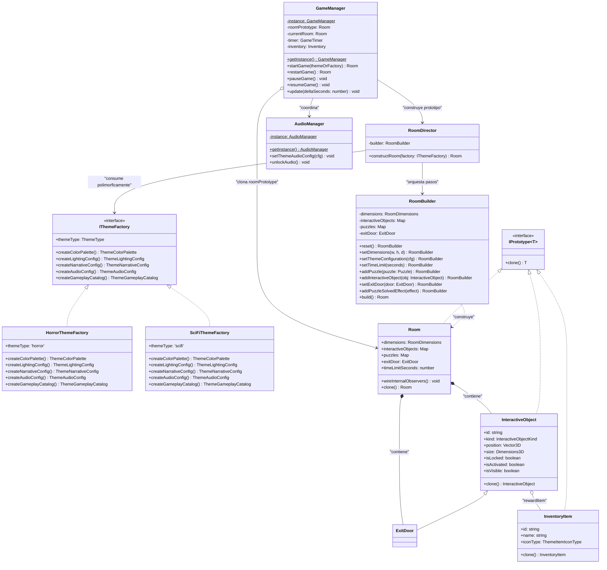

# Arquitectura del Sistema — Escápate!! (Escape Room Interactivo 3D)

Documentación técnica oficial de arquitectura orientada a objetos para el curso de **Tecnología de Objetos** (UNSA — EPIS).

---

## 1. Arquitectura MVC Estricta y Flujo de Interacción

El proyecto **Escápate!!** separa estrictamente su código en tres capas independientes dentro de `src/` para garantizar mantenibilidad, testabilidad y desacoplamiento total respecto al motor gráfico (**Three.js**) y al navegador (**DOM**):

1. **Modelo (`src/model/` y contratos en `src/core/interfaces/`):**
   - Contiene el **100 % de las reglas de negocio y estado del Escape Room**: entidades de sala (`Room`, `InteractiveObject`, `ExitDoor`), inventario (`Inventory`, `InventoryItem`), reloj puro (`GameTimer`), acertijos (`Puzzle`), estrategias de validación (`SequenceStrategy`, `PinCodeStrategy`, `ItemUnlockStrategy`), fábricas temáticas (`HorrorThemeFactory`, `SciFiThemeFactory`) y constructores (`RoomBuilder`, `RoomDirector`).
   - **Frontera estricta:** no importa `three` ni accede a `document`, `window`, `AudioContext` o `setInterval`.
   - Toda comunicación saliente del Modelo ocurre mediante **Observer** (`ISubject<T>` $\rightarrow$ `IObserver<T>`).

2. **Controlador (`src/controller/`):**
   - Actúa como único puente de escritura entre la Vista y el Modelo.
   - Traduce cada intención del jugador (inspeccionar nota, accionar interruptor, ingresar PIN, recoger o usar un ítem) en un comando concreto (`ICommand`), delegando su ejecución y almacenamiento en historial para soportar reversión (`undo()`).

3. **Vista (`src/view/` y consumidores en `src/core/singletons/AudioManager.ts`):**
   - Renderiza la escena 3D procedural con **Three.js** y el **HUD HTML/CSS puro**.
   - Nunca altera directamente reglas ni atributos internos del Modelo: solo **observa** (`IObserver<T>`) las instantáneas emitidas y **envía** eventos de entrada hacia el Controlador.

### Recorrido completo de una interacción del jugador y flujo de 4 acertijos

1. El jugador elige una temática en `MainMenuView` (**Mansión de Terror** o **Nave Sci-Fi**) y entra a la sala en primera persona.
2. En la sala reúne los 3 fragmentos de pista encadenados:
   - **Pista #1 (`desk_note`):** entrega los pasos 1–2 de la secuencia y revela dónde reposa la llave pequeña / chip (`small_key_pickup`).
   - **Acertijo 1 (`desk_box_puzzle` con `ItemUnlockStrategy`):** recoge `small_key_pickup` y abre `desk_box` mediante `UseItemCommand` para revelar la **Pista #2** (pasos 3–4).
   - **Pista #3 (`wall_marking`):** grabada en el muro sur con el paso 5 (con repeticiones).
   - **Acertijo 2 (`sequence_puzzle` con `SequenceStrategy` de 5 pasos):** ingresa `B→A→C→B→A` (Terror) o `C→B→A→C→B` (Sci-Fi) en `ModalView`, encendiendo `clue_wall` (`4829` / `7391`).
   - **Acertijo 3 (`pin_puzzle` con `PinCodeStrategy`):** ingresa el PIN en `safe` mediante el teclado modal, liberando `reward_item_pickup`.
   - **Acertijo 4 (`exit_puzzle` reutilizando `ItemUnlockStrategy`):** recoge el ítem final y abre `exit_door`.
3. Toda interacción desde la escena 3D o modales pasa por `GameController` $\rightarrow$ `CommandInvoker` $\rightarrow$ `ICommand` $\rightarrow$ Modelo, notificando por **Observer** a `ExitDoor`, `Room`, `AudioManager`, `GameManager`, `SceneManager`, `HudView`, `ModalView` y `CommandLogView`.

---

## 2. Diagrama de Arquitectura MVC + Flujo de Datos

---

## 3. Diagrama de Clases UML — Patrones Comportamentales

Detalle de los patrones **Observer**, **Strategy** y **Command** con sus contratos en `src/core/interfaces/` y participantes implementados:

```mermaid
classDiagram
    class IObserver~T~ {
        <<interface>>
        +update(data: T) void
    }

    class ISubject~T~ {
        <<interface>>
        +attach(observer: IObserver~T~) void
        +detach(observer: IObserver~T~) void
        +notify(data: T) void
    }

    class IPuzzleValidationStrategy {
        <<interface>>
        +strategyName: string
        +validate(input: PuzzleInput) ValidationResult
        +reset() void
        +clone() IPuzzleValidationStrategy
    }

    class SequenceStrategy {
        -expectedSequence: string[]
        -currentSequence: string[]
        +addStep(switchId: string) ValidationResult
        +getCurrentSequence() string[]
        +popStep() string
        +reset() void
        +validate(input: PuzzleInput) ValidationResult
        +clone() SequenceStrategy
    }

    class PinCodeStrategy {
        -expectedPin: string
        +validate(input: PuzzleInput) ValidationResult
        +reset() void
        +clone() PinCodeStrategy
    }

    class ItemUnlockStrategy {
        -requiredItemId: string
        +getRequiredItemId() string
        +validate(input: PuzzleInput) ValidationResult
        +reset() void
        +clone() ItemUnlockStrategy
    }

    class Puzzle {
        -id: string
        -isSolved: boolean
        -attempts: number
        -strategy: IPuzzleValidationStrategy
        -observers: Set~IObserver~
        +setStrategy(strategy: IPuzzleValidationStrategy) void
        +attempt(input: PuzzleInput) ValidationResult
        +undoLastStep() boolean
        +reset() void
        +attach(observer: IObserver) void
        +detach(observer: IObserver) void
        +notify(data: PuzzleSnapshot) void
        +clone() Puzzle
    }

    class GameTimer {
        -remainingSeconds: number
        -isRunning: boolean
        +start() void
        +pause() void
        +reset(seconds: number) void
        +tick(deltaSeconds: number) void
        +penalize(seconds: number) void
        +getFormattedTime() string
        +isCritical() boolean
        +isExpired() boolean
    }

    class Inventory {
        -items: InventoryItem[]
        -selectedSlotIndex: number
        +addItem(item: InventoryItem) boolean
        +removeItem(itemId: string) InventoryItem
        +selectSlot(index: number) boolean
        +clear() void
    }

    class ExitDoor {
        -isOpenState: boolean
        +getIsOpen() boolean
        +update(snapshot: PuzzleSnapshot) void
        +clone() ExitDoor
    }

    class AudioManager {
        +playClick() void
        +playSwitchToggle() void
        +playPinKey() void
        +playError() void
        +playSuccess() void
        +playItemPickup() void
        +playDoorOpen() void
        +playCriticalHeartbeat() void
        +update(data: ObservableAudioEvent) void
    }

    class ICommand {
        <<interface>>
        +execute() void
        +undo() void
        +getDescription() string
    }

    class CommandInvoker {
        -history: CommandHistoryEntry[]
        -observers: Set~IObserver~
        +executeCommand(cmd: ICommand) void
        +undoLast() boolean
        +getHistory() CommandHistoryEntry[]
        +clear() void
        +attach(observer: IObserver) void
        +detach(observer: IObserver) void
        +notify(data: CommandHistorySnapshot) void
    }

    class InspectObjectCommand {
        -room: Room
        -objectId: string
        +execute() void
        +undo() void
        +getDescription() string
    }

    class ToggleSwitchCommand {
        -puzzle: Puzzle
        -switchSymbol: string
        +execute() void
        +undo() void
        +canUndo() boolean
        +getDescription() string
    }

    class InputCodeCommand {
        -puzzle: Puzzle
        -pinCode: string
        +execute() void
        +undo() void
        +getDescription() string
    }

    class PickUpItemCommand {
        -room: Room
        -inventory: Inventory
        +execute() void
        +undo() void
        +canUndo() boolean
        +getDescription() string
    }

    class UseItemCommand {
        -room: Room
        -inventory: Inventory
        +execute() void
        +undo() void
        +getDescription() string
    }

    class GameController {
        -commandInvoker: CommandInvoker
        +startNewGame(theme: ThemeType) Room
        +restartCurrentGame() Room
        +handleObjectInteraction(objectId: string, switchSymbol?: SwitchSymbol) void
        +submitSwitch(symbol: string) void
        +submitPinCode(pin: string) void
        +undoLastAction() boolean
        +startLoop() void
    }

    class SceneManager {
        +bindTimer(timer: GameTimer) void
        +buildRoomScene(room: Room) void
        +toggleFlashlight() boolean
        +update(data: SceneObservedSnapshot) void
        +renderFrame(deltaSeconds: number) RaycastTargetHit
    }

    class MainMenuView {
        +update(snapshot: GameStateSnapshot) void
        +show() void
        +hide() void
    }

    class ModalView {
        +openFromInspection(payload: InspectionPayload) void
        +close(resumePointerLock: boolean) void
        +update(snapshot: ModalObservedSnapshot) void
    }

    class HudView {
        +renderHover(hover: HoverTargetInfo, solved: boolean) void
        +showToast(message: string, variant) void
        +update(snapshot: HudObservedSnapshot) void
    }

    class CommandLogView {
        +toggle() boolean
        +update(snapshot: CommandHistorySnapshot) void
    }

    IPuzzleValidationStrategy <|.. SequenceStrategy
    IPuzzleValidationStrategy <|.. PinCodeStrategy
    IPuzzleValidationStrategy <|.. ItemUnlockStrategy
    Puzzle o--> IPuzzleValidationStrategy : "Strategy Context"

    ISubject <|.. Puzzle
    ISubject <|.. GameTimer
    ISubject <|.. Inventory
    ISubject <|.. CommandInvoker
    IObserver <|.. ExitDoor
    IObserver <|.. AudioManager
    IObserver <|.. SceneManager
    IObserver <|.. MainMenuView
    IObserver <|.. ModalView
    IObserver <|.. HudView
    IObserver <|.. CommandLogView
    Puzzle --> ExitDoor : "notifica"
    Puzzle --> AudioManager : "notifica"
    Puzzle --> SceneManager : "notifica"
    Puzzle --> ModalView : "notifica"
    GameTimer --> AudioManager : "notifica"
    GameTimer --> SceneManager : "notifica"
    GameTimer --> HudView : "notifica"
    Inventory --> AudioManager : "notifica"
    Inventory --> HudView : "notifica"
    CommandInvoker --> CommandLogView : "notifica"
    CommandInvoker --> HudView : "notifica"
    CommandInvoker --> ModalView : "notifica"

    ICommand <|.. InspectObjectCommand
    ICommand <|.. ToggleSwitchCommand
    ICommand <|.. InputCodeCommand
    ICommand <|.. PickUpItemCommand
    ICommand <|.. UseItemCommand
    CommandInvoker o--> ICommand : "invoca y revierte"
    GameController --> CommandInvoker : "despacha comandos"
    GameController --> SceneManager : "coordina Vista 3D"
    ToggleSwitchCommand ..> Puzzle : "opera + popStep()"
    InputCodeCommand ..> Puzzle : "valida PIN"
    PickUpItemCommand ..> Inventory : "agrega/remueve item"
    UseItemCommand ..> Puzzle : "resuelve salida"
```

---

## 4. Diagrama de Clases UML — Patrones Creacionales

Detalle de **Abstract Factory**, **Builder**, **Prototype** y **Singleton** en `src/model/` y `src/core/singletons/`:

---

## 5. Tabla Resumen de Patrones de Diseño del Repositorio

| Categoría | Patrón | Clases / Contratos Concretos | Problema de Diseño que Resuelve |
| --- | --- | --- | --- |
| **Arquitectónico** | **MVC** | Modelo (`src/model/`), Vista (`SceneManager`, `CameraController`, `RaycastSelector`, `RoomMeshFactory`, `ProceduralTextureFactory`, `MainMenuView`, `ModalView`, `HudView`, `CommandLogView`), Controlador (`GameController`) | Aísla al 100 % las reglas de dominio de Three.js y del DOM para poder probar, clonar y evolucionar cada capa sin acoplamientos. |
| **Comportamental** | **Observer** | `ISubject<T>`, `IObserver<T>`, `GameTimer`, `Inventory`, `Puzzle`, `Room`, `CommandInvoker`, `ExitDoor`, `GameManager`, `AudioManager`, `SceneManager`, `MainMenuView`, `ModalView`, `HudView`, `CommandLogView` | Desacopla la emisión de cambios de estado del Modelo e Invoker de los múltiples consumidores reactivos (puerta, audio, sala, escena 3D, HUD, modales y log). |
| **Comportamental** | **Strategy** | `IPuzzleValidationStrategy`, `Puzzle` (Context), `SequenceStrategy` (5 pasos), `PinCodeStrategy`, `ItemUnlockStrategy` (reutilizada en `desk_box` y `exit_door`) | Permite validar secuencias con `popStep()`, PIN de 4 dígitos o uso de ítems sin condicionales rígidos ni herencia explosiva en `Puzzle`. |
| **Comportamental** | **Command** | `ICommand`, `CommandInvoker`, `InspectObjectCommand`, `ToggleSwitchCommand`, `InputCodeCommand`, `PickUpItemCommand`, `UseItemCommand` | Encapsula acciones del jugador como objetos autónomos con historial cronológico observable y soporte nativo de reversión (`undo()`). |
| **Creacional** | **Abstract Factory** | `IThemeFactory`, `HorrorThemeFactory`, `SciFiThemeFactory` | Garantiza familias coherentes de colores, luces, narrativa, audio y acertijos por temática sin `if/switch` en `RoomDirector`. |
| **Creacional** | **Builder** | `RoomBuilder`, `RoomDirector`, producto `Room` | Separa la construcción paso a paso y el posicionamiento sin solapamientos de una sala 10×4×10 m de su representación final. |
| **Creacional** | **Prototype** | `IPrototype<T>`, `Room`, `Puzzle`, `InteractiveObject`, `ExitDoor`, `Inventory`, `InventoryItem`, estrategias | Clona profundamente la sala inicial (`roomPrototype.clone()`) para reiniciar partidas al instante sin reconstruir el escenario lógico. |
| **Creacional** | **Singleton** | `GameManager`, `AudioManager` | Provee puntos únicos controlados de coordinación global de partida y síntesis Web Audio API protegida. |
